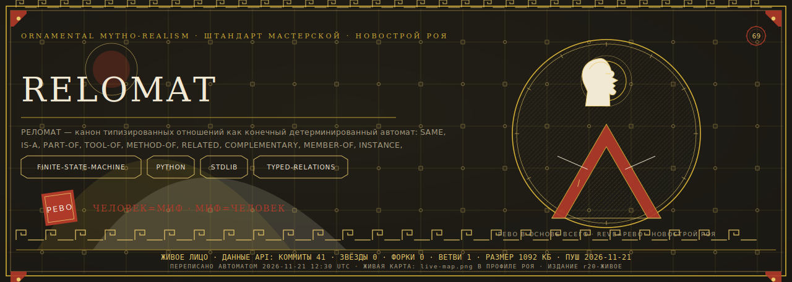
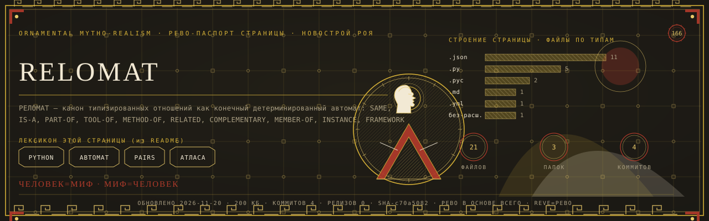

<div align="center">

<a href="https://github.com/rtynbirf/relomat"></a>

</div>

<!--ФОРЖ:ПАСПОРТ:НАЧАЛО-->
<div align="center">
  
</div>

| ФАЙЛОВ | ПАПОК | КОММИТОВ | ОБНОВЛЕНО | РЕЛИЗОВ |
|---:|---:|---:|---|---:|
| 36 | 4 | 40 | 2026-11-21 | 0 |
<!--ФОРЖ:ПАСПОРТ:КОНЕЦ-->

# РЕЛОМАТ — автомат типизированных отношений

**ВЕРСИЯ:** 1.0 · **ДАТА:** 2026-11-20 · **СТАТУС:** работает (unittest 11/11 · пары 43/43 · эмерджентные 11/11)

## Что это

Канон типизированных отношений роя, переведённый в **конечный детерминированный автомат** (stdlib-only Python).
Канон: не объединять категорию с методом, свойство с инструментом, экземпляр с классом; похожее название ≠
одинаковая сущность — сравниваются предмет, механизм, назначение и границы применимости. Большинство
«похожих» позиций получают не MERGE, а типизированное отношение из словаря.

Доктрина «проверяй строкой, не смыслом»: признаки извлекаются из текста строки регулярками, вердикт —
детерминированная таблица переходов с полной трассой.

## Автомат

- **Q** = {S0-вход, S1-нормализация, S2-имя, S3-роль, S4-семейство, S5-роль-строка, S6-вердикт, HALT}
- **Словарь (10):** SAME, IS-A, PART-OF, TOOL-OF, METHOD-OF, RELATED, COMPLEMENTARY, MEMBER-OF, INSTANCE, FRAMEWORK
- **Три потока доказательств:**
  - **П1** точное имя + пересечение РОЛЕЙ → SAME (расхождение кода типа между источниками — пометка аудиту)
  - **П2** строка-аннотация «REL: №цель — …» → вердикт из строки; канонические запреты проверяются по ролям,
    ошибочный SAME исправляется автоматом с регистрацией нарушения
  - **П3** лексический/ролевой путь: вложенность имён → IS-A; роль-пара (инструмент×метод → TOOL-OF,
    стандарт×практика → METHOD-OF, стандарт×принцип → INSTANCE); пересечение токенов ≥2 при одной роли → MEMBER-OF;
    ≥1 → RELATED; иначе NEW
- **Роль — множество** по всем частям двойного кода (H/M → {hypothesis, practice}); SAME — при непустом пересечении.

## Запуск

```bash
python relomat.py pairs.json                # верификация пар: вердикт vs ожидание
python relomat.py pairs.json --trace        # с полной трассой переходов
python -m unittest test_relomat -v          # тесты канона (11)
python build_pairs.py                       # сборка пар из данных атласа
python emergent.py                          # эмерджентные кандидаты 1146–1154
```

## Результаты (2026-11-20)

| Проверка | Итог |
|---|---|
| Юнит-тесты канона (запреты, роли, словарь) | 11/11 OK |
| Верификация решений атласа v1.2 (34 пары V2) | 34/34 |
| Пары из Реестра вердиктов 001–200 (строки аудита) | 5/5 |
| Категориальные ловушки (категория×метод, свойство×инструмент, экземпляр×класс) | 4/4 |
| Эмерджентные кандидаты 1146–1154 (тренды 2026) | 11/11 |

## Границы (честно)

- Фичи — регулярок по строке: текст, не написанный строкой, автомат не видит.
- Роли выводятся из 12 кодов типов V2 + тул-лексикона; новая таксономия требует калибровки.
- Автомат верифицирует и классифицирует по канону, но НЕ заменяет аудит полных формулировок: SAME
  констатируется строкой, окончательное поглощение — только после сверки полных текстов.

## Интеграция

Данные атласа: **global-practice-atlas** (паспорта 1145, канон v1.2, досье трендов).
Строки-отношения атласа в машиночитаемом виде: `pairs.json`, `emergent_pairs.json`.

## Быстрый запуск

`python3 run_all.py` — сборка пар, конечный автомат, эмерджентные линии (11/11), юнит-тесты; ненулевой код при любом расхождении.
